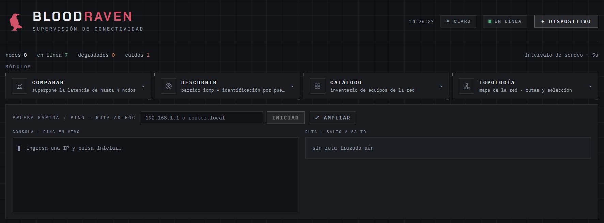
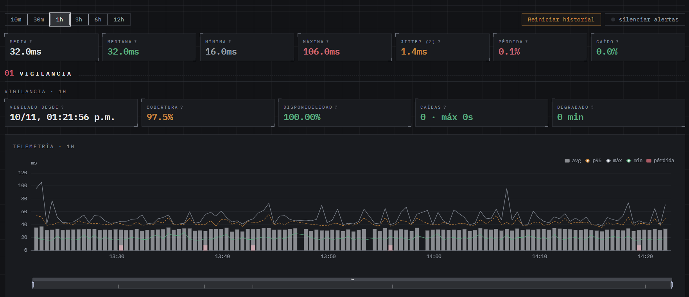
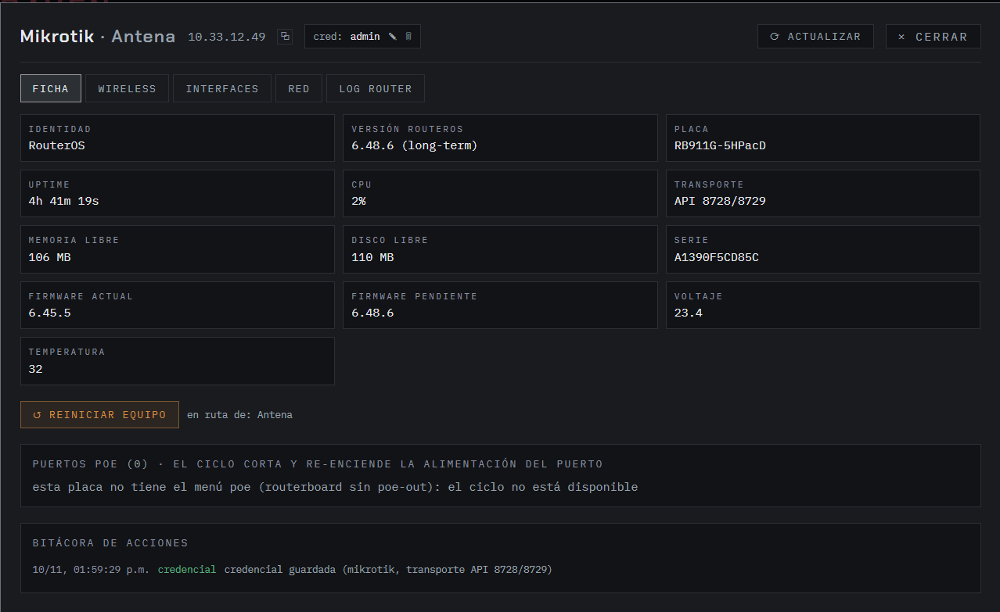

# Bloodraven

[](LICENSE)


Monitoreo de conectividad
(MikroTik RouterOS y Ubiquiti airMAX/aireOS). Ping continuo, detección de caídas
(outages), trazado de hops con reverse-DNS, dashboards de latencia y ficha de
telemetría por equipo — todo standalone, corriendo en Windows.

> Pensado para operadores WISP / redes con múltiples radios y routers: ese "¿qué
> se cayó y por dónde?" con detalle por hop, y el "¿cómo está esa celda ahora?"
> señal/CCQ/potencial/estaciones sin abrir la web de cada equipo.







## Características

- **Ping continuo** con `ping.exe` nativo (sin permisos admin), RTT por muestra.
- **Outages**: detección automática (caída/degradado), causa y **snapshot de hops**
  guardado en el evento; re-scan urgente al caer.
- **Dashboards** de latencia por dispositivo (raw, 1m, 1h, 1d con agregación
  nocturna y purga por retención).
- **Comparativa**: gráficas de latencia de varios dispositivos lado a lado.
- **Descubrimiento**: barrido ICMP de una subred (hosts vivos con RTT) e
  identificar manualmente los hallazgos.
- **Catálogo de equipos**: por IP con nombre, rol (router/agregador, radio/antena,
  celda, switch, cámara, DVR, PC…) y notas; nombre/notas también se pueden
  completar por firmas de banner del sondeo.
- **Copias de seguridad del catálogo**: exportar/importar el catálogo en JSON
  (modos *combinar* o *reemplazar*) e **importar el XML de The Dude** de MikroTik
  (DeviceType + Device, hasta 20k equipos; lo catalogado a mano prevalece).
- **Topología**: 
  - *por dispositivo*: ruta de referencia, cambios de ruta observados e
    identificación de hosts por hop (reverse-DNS en caché);
  - *general persistente*: grafo **acumulativo** de la red — nodos y aristas de
    los traceroutes de los dispositivos seleccionados se registran y quedan
    (capas por BFS desde los gateways; lo sin escaneos recientes se dibuja
    atenuado; "reasentar" reconstruye).
- **Diagnóstico y prueba rápida**: ping/traceroute ad-hoc sin registrar el
  dispositivo; sondeo de ruta en vivo.
- **Panel de acceso a equipos** (por IP, con credencial cifrada):
  - MikroTik RouterOS v7: ficha, wireless (registration-table, autodetecta
    esquema classic / wireless-fp / wifi-v7), interfaces, red (ARP+rutas),
    log del router, ciclo PoE y reinicio.
  - Ubiquiti airMAX/aireOS (SSH): ficha con señal, ruido, modo radio,
    frecuencia, txpower y estaciones conectadas vía `wstalist` (device
    name/model, señal remota, link potencial, capacidades dn/up, airtime,
    throughput), y reinicio.
- **Alertas** por Telegram o webhook en caída/recuperado (opcional).
- Corre en la **bandeja del sistema** (icono de halcón) o headless.

## Arquitectura

- **Backend**: FastAPI + SQLAlchemy async + PostgreSQL + APScheduler.
- **Motor de probes**: tareas asyncio por dispositivo; traceroute cada N minutos
  + scan urgente al detectar outage; snapshot de hops en el evento.
- **Frontend**: Vite + React + TypeScript + Tailwind + ECharts, servido por
  FastAPI (build a `static/`).
- **Equipo panel**: librouteros (API/REST MikroTik) y asyncssh (aireOS) con
  caché TTL de lecturas y credenciales cifradas con Fernet.

## Equipos verificados

| Marca | Firmware probado |
|---|---|
| MikroTik | RouterOS v7.x (REST `/rest` y API 8728/8729) |
| Ubiquiti airMAX | aireOS XC.v8.7.11 (Rocket Prism 5AC Gen2, modo AP) — compatibles XM/XW vía `mca-status.sh` |

Otros aireOS (NanoBeam, LiteBeam, Bullet…) y RouterOS fuera de los rangos
probados deberían funcionar; los comandos se detectan de forma tolerante.

## Requisitos

- Windows 10/11 (los scripts son PowerShell; el backend también corre en Linux headless)
- Python 3.12+
- PostgreSQL 13+ (cualquier instancia local)
- Node.js 20+ (solo para compilar el frontend)

## Instalación

```powershell
git clone https://github.com/AlejandroAP98/Bloodraven.git
cd bloodraven

# 1. config: copia el ejemplo y apunta a tu PostgreSQL
Copy-Item .env.example .env
# edita .env (DATABASE_URL con usuario/clave/port/db reales)

# 2. database: crea la base si no existe
psql -U postgres -c "CREATE DATABASE bloodraven;"

# 3. frontend (una vez)
cd frontend; npm ci; npm run build; cd ..

# 4. arranca: crea el venv, corre migraciones y abre el dashboard
.\run.ps1
```

Dashboard: http://127.0.0.1:8080/ — `run.ps1` es idempotente: si el servidor ya
responde, solo abre la interfaz.

### Arranque sin consola (accesos directos)

Doble clic en el Escritorio (crear una vez con `.\instalar_accesos.ps1`):

- **Bloodraven** — si el servidor ya responde solo abre la interfaz; si no,
  corre migraciones y arranca oculto.
- **Detener Bloodraven** — termina el proceso (por PID guardado; si se perdió,
  busca el proceso que escucha en el puerto).

Mientras corre, hay un **icono de halcón en la bandeja del sistema**: clic
izquierdo abre la interfaz; clic derecho ofrece *Abrir interfaz* / *Detener
servidor* (cierre limpio). Estado interno en `logs/`: `bloodraven.pid`,
`bloodraven.log`, `bloodraven.err.log`.

### Auto-arranque al iniciar sesión

```powershell
schtasks /create /tn Bloodraven /sc onlogon /tr "powershell -ExecutionPolicy Bypass -File C:\ruta\a\bloodraven\run.ps1"
```

## Config (`.env`)

| Variable | Default | Nota |
|---|---|---|
| DATABASE_URL | — | obligatorio; apunta a tu PostgreSQL |
| HOST / PORT | 127.0.0.1:8080 | escucha local por defecto |
| PING_TIMEOUT_MS | 1000 | |
| MAX_PINGS_CONCURRENTES | 50 | |
| MAX_TRACERTS_CONCURRENTES | 4 | |
| HOP_SCAN_INTERVAL_MIN | 10 | escaneo de ruta por dispositivo |
| N_FALLOS_DOWN | 3 | pings seguidos para abrir outage |
| N_MUESTRAS_DEGRADADO | 4 | para estado degradado |
| RETENCION_RAW_DIAS / RETENCION_1MIN_DIAS | 30 / 180 | purga nocturna |
| CONSOLIDADOR_HORA | 3 (am) | job de agregación |
| BANDEJA | true | 0 = servidor headless |
| TELEGRAM_BOT_TOKEN / TELEGRAM_CHAT_ID | "" | alertas |
| WEBHOOK_URL | "" | alertas (payload JSON) |
| CREDENCIAL_CLAVE | "" | Fernet; vacío = autogenera `credencial_clave.key` (fuera de git) |

## Panel de acceso a equipos

**Panel `◆ acceso` de cada dispositivo** (por IP; la credencial se valida
contra el equipo antes de guardarse y queda cifrada con Fernet):

| Marca | Transporte | Lecturas | Acciones |
|---|---|---|---|
| mikrotik | REST v7 `/rest` o API 8728/8729 | ficha, wireless, interfaces, red, log | poe_cycle, reboot |
| ubiquiti (airMAX/aireOS) | SSH 22 (asyncssh) | ficha (`mca-status` / `mca-dump` + `/tmp/system.cfg`) y wireless (`wstalist`) | reboot |

En el radio Ubiquiti: habilitar **System → Services → SSH** (puerto 22) con
usuario/contraseña del radio. Los endpoints (`/api/acciones/{ip}/...`) son los
mismos para ambas marcas: `wireless` despacha por marca (RouterOS →
registration-table / aireOS → wstalist); `interfaces/red/log_router` solo
aplican a mikrotik (son menús RouterOS).

### API principal

```
GET    /api/status
GET/POST /api/devices
GET/PUT/DELETE /api/devices/{id}
GET    /api/devices/{id}/samples?desde=&resolucion=raw|1m|1h|1d
GET    /api/devices/{id}/outages?desde=
GET    /api/devices/{id}/hops?ts=
GET    /api/outages/{id}
GET    /api/health

# investigación
GET    /api/devices/{id}/ping_ahora          # ping puntual
GET    /api/devices/{id}/sondeo_ruta         # traceroute en vivo
GET    /api/devices/{id}/diagnostico         # ruta de referencia + cambios
GET    /api/devices/{id}/ruta_referencia
GET    /api/devices/{id}/cambios_ruta
GET/POST /api/descubrir                      # barrido ICMP de subred
POST   /api/identificar                      # catalogar un hallazgo
GET /api/prueba/ping | /api/prueba/ruta      # ad-hoc, sin registrar

# catálogo de equipos
GET/PUT/DELETE /api/equipos_red/{ip}         # catálogo: nombre, rol, notas
POST   /api/equipos_red/exportacion          # IMPORTAR JSON del catálogo (combinar|reemplazar)
POST   /api/equipos_red/importado            # IMPORTAR XML de The Dude

# topología
GET    /api/topologia                        # mapa inferido de la ventana
GET    /api/topologia_general                # grafo persistente acumulativo
PUT/DELETE /api/devices/{id}/topologia       # incluir/quitar del grafo
POST   /api/topologia_general/reasentar      # reconstruir grafo

# acciones por dispositivo (por marca):
GET    /api/acciones/{ip}/info          # ficha
GET    /api/acciones/{ip}/wireless      # registration-table / wstalist
GET    /api/acciones/{ip}/interfaces    # (mikrotik)
GET    /api/acciones/{ip}/red            # (mikrotik)
GET    /api/acciones/{ip}/log_router     # (mikrotik)
POST   /api/acciones/{ip}/credencial     # guardar/rotar (valida antes)
POST   /api/acciones/{ip}/reboot         # {confirmar: true}
POST   /api/acciones/{ip}/poe_cycle      # (mikrotik) {confirmar: true, puerto}
```

## Seguridad (léelo antes de exponer nada)

- Las credenciales de equipos se guardan **cifradas con Fernet**; la clave vive
  en `credencial_clave.key` (fuera de git). Sin esa clave, lo guardado no se
  descifra.
- Por defecto el servidor **escucha en 127.0.0.1**: para usarlo en red/LAN,
  cambia `HOST` — y de forma **obligatoria** protégelo detrás de un
  reverse-proxy con TLS y autenticación; Bloodraven no incluye login propio
  por ahora.
- El SSH hacia aireOS **no verifica host key** (los radios usan claves
  autofirma y rotan al flashear): es una concesión pensada para equipos de
  campo, tenlo presente. Las credenciales se usan solo contra la IP guardada.
- `reboot` y `poe_cycle` requieren confirmación explícita y registran entrada
  en bitácora con who/what/when.

## Desarrollo

```powershell
cd frontend; npm run dev       # vite con proxy /api -> :8080
.venv\Scripts\python -m app.main  # backend
cd frontend; npm run build     # regenerar static/ tras cambios
```

## Licencia

[MIT](LICENSE) — úsalo, modifícalo y compártelo libremente.
